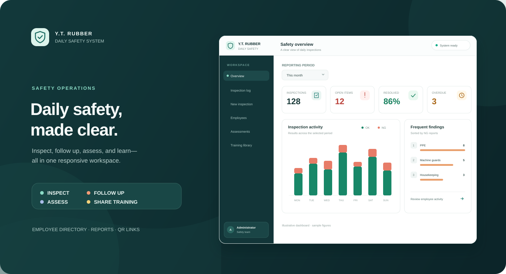

# Daily Safety System

<p align="center"><strong>ระบบตรวจความปลอดภัยประจำวัน — Y.T. Rubber</strong><br />บันทึกการตรวจ ติดตามงานแก้ไข ประเมินความรู้ และส่งสื่ออบรมให้พนักงานในระบบเดียว</p>

<p align="center">
  
  
  
  
  
</p>

<p align="center"></p>

## ภาพรวม

เว็บแอปสำหรับทีมความปลอดภัยและหัวหน้างาน ใช้ได้ทั้งคอมพิวเตอร์และมือถือ รองรับภาษาไทยและอังกฤษ ข้อมูลตรวจและหลักฐานรูปเก็บใน SQLite พร้อมหน้ารายงานสำหรับติดตามผลและการแก้ไข

> ภาพด้านบนเป็นภาพประกอบหน้าตาระบบ โดยใช้ตัวเลขตัวอย่าง

## ความสามารถหลัก

| ส่วนงาน | ทำอะไรได้บ้าง |
| --- | --- |
| **ภาพรวม** | ดูจำนวนการตรวจ ผล OK / NG / N/A งานค้าง งานเกินกำหนด และหัวข้อที่พบปัญหาบ่อย พร้อมตัวกรองสถานะ |
| **รายการตรวจ** | ค้นหาและกรองตามวันที่ พื้นที่ กะ ผู้ตรวจ รหัสพนักงาน ผลตรวจ และหัวข้อตรวจ ดูหลักฐานภาพและติดตามสถานะงานได้ |
| **งานแก้ไข** | มอบหมายผู้รับผิดชอบ ติดตามกำหนดเสร็จ บันทึกการแก้ไข และแนบรูปก่อนหรือหลังแก้ไข |
| **พนักงาน** | จัดการทะเบียนพนักงานสองภาษา ค้นหาและเลือกชื่อหรือรหัสจากรายการอัตโนมัติ |
| **รายงานรายบุคคล** | รวมประวัติรายการตรวจ งานแก้ไขที่รับผิดชอบ ผลแบบประเมิน และสื่ออบรมที่อ่านแล้วตามรหัสพนักงาน |
| **แบบประเมิน** | จัดการชุดคำถาม เผยแพร่ลิงก์หรือ QR Code ดูรายงานคำตอบ และส่งออก Excel ได้ |
| **สื่ออบรม** | แนบ PDF หรือรูปภาพ สร้างลิงก์และ QR Code สำหรับให้พนักงานเปิดดูโดยไม่ต้องเข้าสู่ระบบ |

### ตัวอย่างสื่อ

มีชุดตัวอย่างแบบประเมินความปลอดภัย 18 ข้อและเอกสารอบรมภาษาไทย 3 หน้า ระบบเพิ่มรายการตัวอย่างให้เมื่อเริ่มทำงานครั้งแรกหลังติดตั้ง

[เปิดคู่มืออบรมความปลอดภัย (PDF)](output/pdf/safety-essentials-training-th.pdf)

## เริ่มใช้งานในเครื่อง

ต้องใช้ Node.js 24 ขึ้นไปและ pnpm

```powershell
corepack enable
pnpm install
pnpm dev
```

เปิดเว็บที่ <http://localhost:5173> คำสั่งเดียวกันจะเริ่มทั้งเว็บและ API

บัญชีตัวอย่างสำหรับฐานข้อมูลใหม่ในเครื่อง:

| บทบาท | ชื่อผู้ใช้ | รหัสผ่าน |
| --- | --- | --- |
| ผู้ดูแลระบบ | `admin` | `Admin@123` |
| หัวหน้างาน | `leader` | `Leader@123` |

**บัญชีนี้ใช้สำหรับพัฒนาในเครื่องเท่านั้น** ก่อน deploy ให้กำหนดรหัสผ่านจริงใน `.env`

## นำเข้าทะเบียนพนักงาน

ใช้ไฟล์ภาษาไทยและอังกฤษที่มีคอลัมน์ `Code`, `Name`, `Position`, `Department` และมีชุดรหัสพนักงานตรงกันทั้งสองไฟล์

```powershell
node server/import-employees.js "C:\path\to\employees-th.xlsx" "C:\path\to\employees-en.xlsx"
```

สคริปต์จะเพิ่มหรือปรับปรุงข้อมูลในฐานข้อมูลของแอป โดยไม่ลบค่าภาษาที่มีอยู่เมื่อช่องจากไฟล์ใดไฟล์หนึ่งว่าง

## Deploy ด้วย Docker

```sh
cp .env.example .env
```

แก้ `SESSION_SECRET`, `ADMIN_PASSWORD` และ `LEADER_PASSWORD` ใน `.env` ให้เป็นค่าที่คาดเดายาก จากนั้นรัน:

```sh
docker compose up -d --build
```

แอปใช้พอร์ต `4000` ภายใน Docker และออกแบบให้วางหลัง Nginx Proxy Manager ตามค่าที่กำหนดใน `compose.yaml` ข้อมูล SQLite และรูปแนบอยู่ใน volume `daily-safety-data` สำรอง volume นี้เป็นประจำ และอย่า commit ไฟล์ `.env` หรือข้อมูลใน `data/`

## ข้อมูลและข้อกำหนด

- ฐานข้อมูล: `data/daily-safety.sqlite`
- รูปและเอกสารที่อัปโหลด: `data/uploads/`
- รองรับผลตรวจ `OK`, `NG`, `N/A` โดย `N/A` ถือว่าตรวจแล้ว
- รายการ `NG` ต้องมีรายละเอียด ผู้รับผิดชอบ และรูปก่อนแก้ไข
- รูปใหญ่กว่า 8 MB จะถูกบีบอัดในหน้ากรอกแบบตรวจ และจำกัดขนาดรวมต่อแบบตรวจไว้ที่ 60 MB
- ลิงก์แบบประเมินและสื่ออบรมเปิดได้โดยไม่ต้อง login; ข้อมูลผู้ทำแบบประเมินจะถูกตรวจเทียบกับทะเบียนพนักงาน

## โครงสร้างและมาตรฐาน UI

ดู [โครงสร้างโปรเจกต์ สเกลขนาด และระบบสี](docs/ui-design-system.md) ก่อนเพิ่มหน้าใหม่ เพื่อให้หน้าแอปและแบบฟอร์มสาธารณะใช้แนวทางเดียวกัน

## เทคโนโลยี

React · TypeScript · Vite · Tailwind CSS · shadcn/ui · Express · SQLite · ExcelJS · Sharp · Docker
